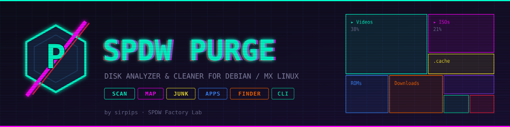
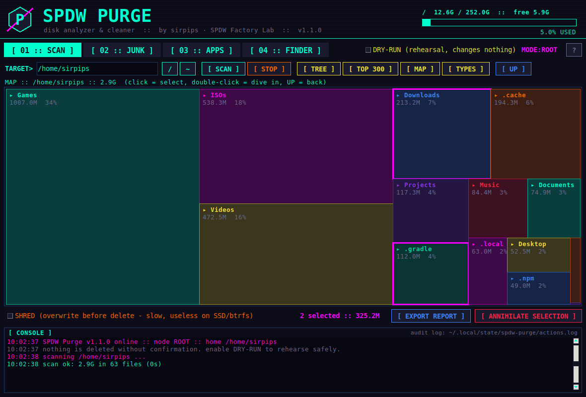
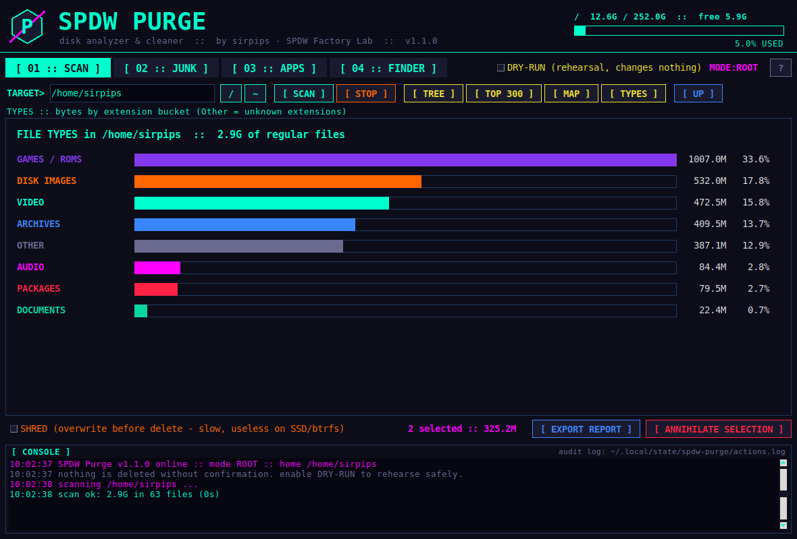
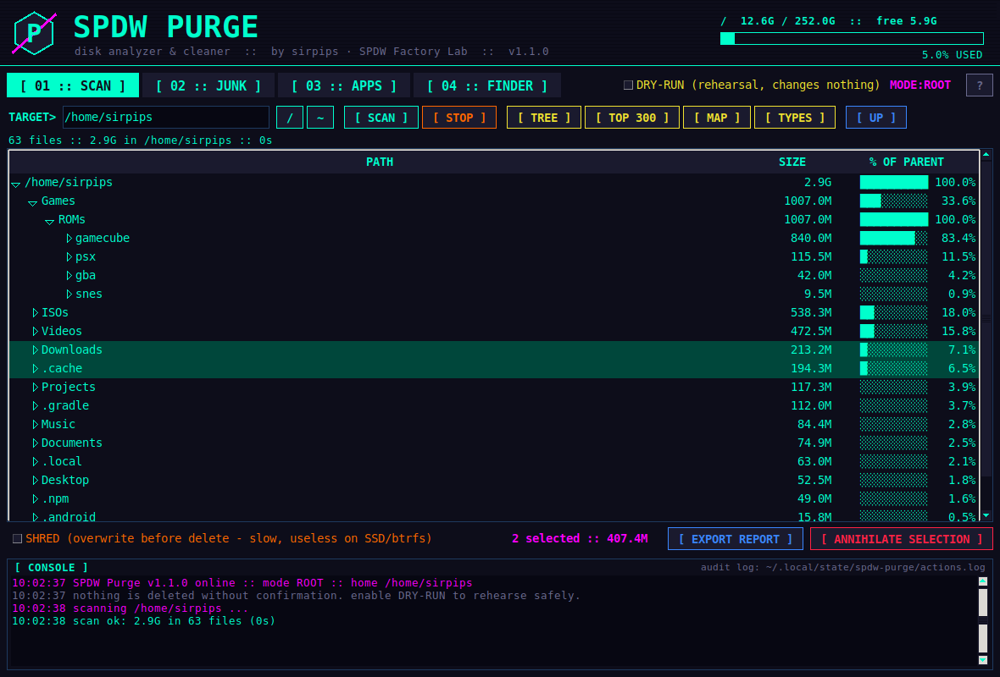
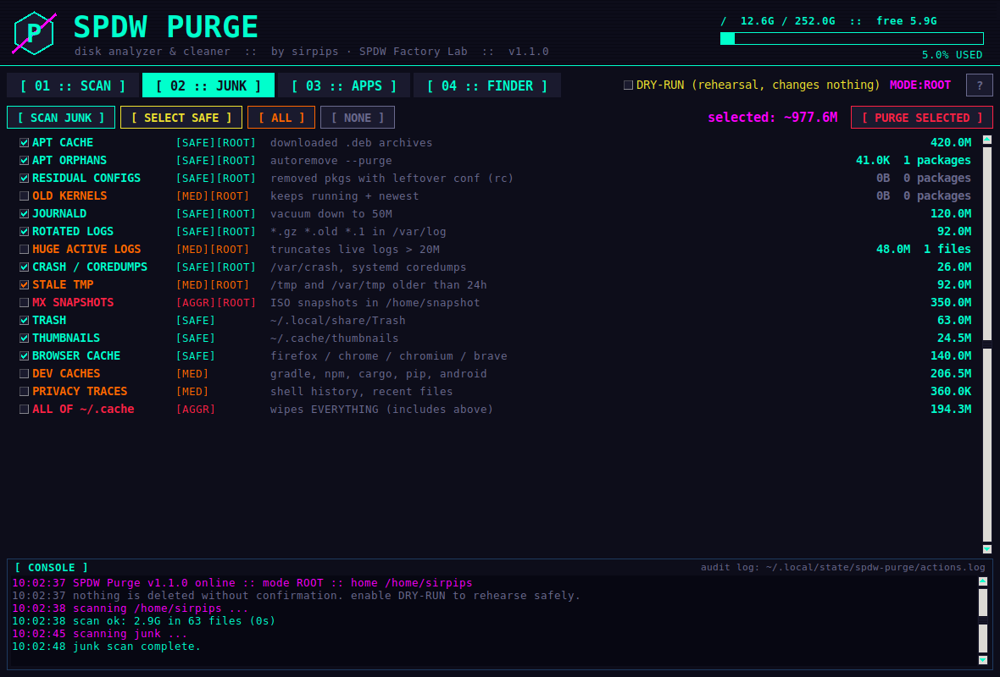
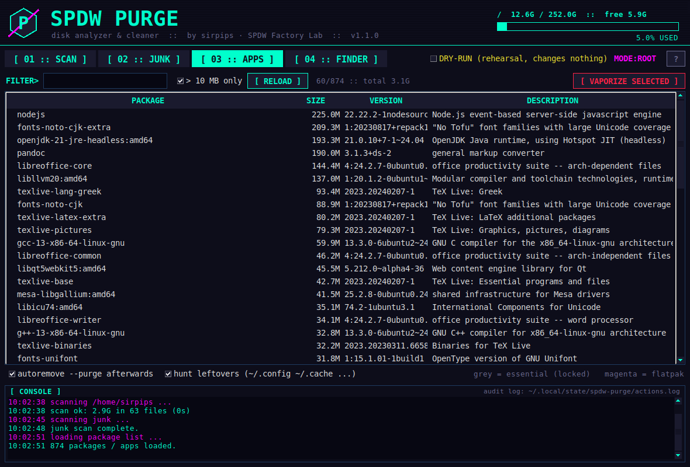
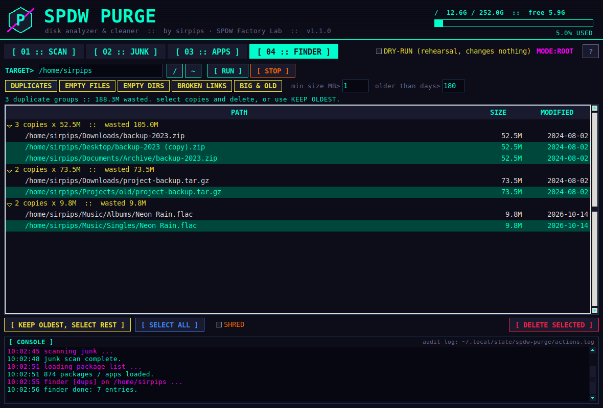
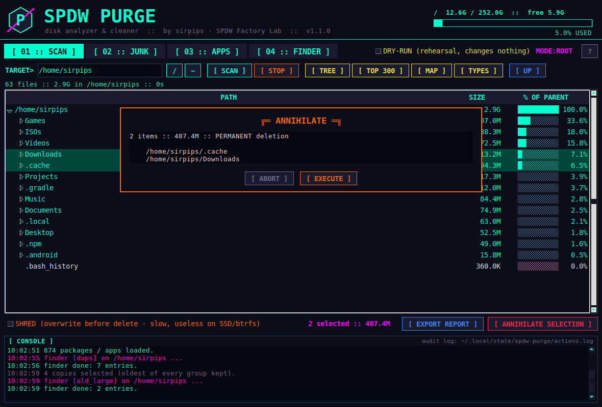

<p align="center">
  
</p>

<p align="center">
  <a href="LICENSE"></a>
  
  
  
  
</p>

<p align="center"><b>Find what eats your disk — then wipe it.</b><br>
Treemap scanner · junk cleaner · full package removal · duplicate finder · CLI.<br>
One tool, neon-noir.</p>

---

## Why

Cleaning a Linux box usually means juggling a disk-usage viewer, a cache cleaner, `apt` incantations and a
duplicate finder. **SPDW Purge** puts them in one place, with the safety rails you want when the verb is *delete*:
every action is confirmed, logged, and can be rehearsed first with **DRY-RUN**.

Built for **MX Linux (Xfce)** and works on any Debian-based distro.

## Features

| Tab | What it does |
|---|---|
| **01 · SCAN** | Interactive **treemap**, size-sorted **tree**, **top 300 files**, **file-type breakdown**. Select anything and annihilate it, optionally with `shred`. Right-click: open in file manager, copy path, scan folder. One-click **Markdown report**. |
| **02 · JUNK** | 19 cleanable categories with measured sizes and risk levels (SAFE / MED / AGGR): APT cache & orphans, residual configs, **old kernels**, journald, logs, crash dumps, stale `/tmp`, **MX snapshots**, Docker/Podman, browser/dev caches, trash, privacy traces, Flatpak runtimes. |
| **03 · APPS** | Every installed package and Flatpak with its size. **Dry-simulates** the removal first (shows dependencies that get dragged along), then `purge` + `autoremove --purge`, then **hunts leftovers** in `~/.config`, `~/.cache`, `~/.local/share`, `/etc`… |
| **04 · FINDER** | **Duplicate files** (size → head hash → full hash, hardlink-aware), **empty files**, **empty folders**, **broken symlinks**, **big & old files**. *Keep oldest, select the rest* in one click. |
| **CLI** | `--list`, `--clean safe\|all\|keys`, `--top PATH`, `--dry-run`, `--yes` — scriptable and cron-friendly. |

### Safety model

- **Confirmation on every deletion**; dangerous targets (`/usr`, `/etc`, `/boot`, critical packages, whole `~/.cache`,
  old kernels, MX snapshots…) require **typing a keyword**.
- `/`, `/usr`, `/home`, your `$HOME`, mount points and friends are **hard-protected** and can never be deleted.
- Essential packages are locked in APPS; removals are **simulated with `apt-get -s`** before anything happens.
- **DRY-RUN** switch (GUI + `--dry-run`): everything is logged, nothing is touched.
- **Audit log** of every action: `~/.local/state/spdw-purge/actions.log`.
- Runs as root through **pkexec** only when needed; declining the prompt gives a limited user mode.

## Screenshots

<table>
  <tr>
    <td width="50%"><br><sub><b>SCAN · treemap</b> — click to select, double-click to dive in</sub></td>
    <td width="50%"><br><sub><b>SCAN · file types</b> — see which kind of file hogs the disk</sub></td>
  </tr>
  <tr>
    <td><br><sub><b>SCAN · tree</b> — lazy, size-sorted, with % of parent</sub></td>
    <td><br><sub><b>JUNK</b> — measured categories with risk levels</sub></td>
  </tr>
  <tr>
    <td><br><sub><b>APPS</b> — full removal with simulation and leftover hunting</sub></td>
    <td><br><sub><b>FINDER</b> — duplicates, keep oldest, select the rest</sub></td>
  </tr>
  <tr>
    <td colspan="2" align="center"><br><sub><b>Every deletion is confirmed</b></sub></td>
  </tr>
</table>

## Install

### From the `.deb` (recommended)

Grab `spdw-purge_<version>_all.deb` from the [Releases](../../releases) page:

```bash
sudo apt install ./spdw-purge_1.1.0_all.deb
```

Launch **SPDW Purge** from the menu, or run `spdw-purge`.

### From source

```bash
sudo apt install python3 python3-tk          # runtime deps
git clone https://github.com/sirpips/spdw-purge.git
cd spdw-purge
make run                                     # GUI, no install needed
sudo make install                            # or install system-wide
make deb                                     # build dist/spdw-purge_<version>_all.deb
```

Optional: `deborphan` (orphan libraries), `flatpak`, `pkexec` (privilege elevation).

## Usage

```bash
spdw-purge                       # GUI (asks for root via pkexec)
spdw-purge --dry-run             # GUI in rehearsal mode

spdw-purge --list                # measure every junk category
sudo spdw-purge --clean safe     # clean all SAFE categories (asks for confirmation)
sudo spdw-purge --clean apt_cache,journal,tmp --yes
sudo spdw-purge --clean all --dry-run
spdw-purge --top ~               # biggest folders, file types and files
```

Run a weekly safe clean with cron:

```cron
0 4 * * 0  root  /usr/bin/spdw-purge --clean safe --yes >> /var/log/spdw-purge.log 2>&1
```

## Junk categories

| Key | Level | Cleans |
|---|---|---|
| `apt_cache` | SAFE | downloaded `.deb` archives (`apt-get clean`) |
| `apt_auto` | SAFE | orphaned packages (`autoremove --purge`) |
| `rc_conf` | SAFE | configs of removed packages (`rc` state) |
| `journal` | SAFE | systemd journal, vacuumed to 50 MB |
| `old_logs` | SAFE | rotated logs (`*.gz`, `*.old`, `*.1`, dated) |
| `crash` | SAFE | `/var/crash`, systemd coredumps |
| `trash` · `thumbs` · `browser` | SAFE | trash, thumbnails, Firefox/Chrome/Chromium/Brave caches |
| `flatpak` | SAFE | unused Flatpak runtimes |
| `deborphan` | MED | orphan libraries *(needs `deborphan`)* |
| `kernels` | MED | old kernels + headers — **keeps the running and the newest** |
| `biglogs` | MED | truncates live logs bigger than 20 MB |
| `tmp` | MED | `/tmp` and `/var/tmp` entries older than 24 h |
| `docker` · `podman` | MED | `system prune -f` *(if installed)* |
| `dev` | MED | Gradle, npm, Cargo, pip, Android caches |
| `privacy` | MED | shell history, recently-used list |
| `mx_snapshots` | AGGR | MX Snapshot ISOs in `/home/snapshot` |
| `cache_user` | AGGR | the whole `~/.cache` |

`--clean safe` only touches SAFE categories; destructive ones must be named explicitly.

## How it works

- **Scanner** — iterative `scandir` walk that stays on one filesystem, counts *allocated blocks* (what `du` reports),
  de-duplicates hardlinks, and feeds a squarified treemap layout.
- **Finder** — three-stage duplicate detection: group by size → hash the first 64 KB → hash the full file only when the
  heads match.
- **APPS** — `dpkg-query` for the inventory, `apt-get -s` to simulate, `apt-get purge` to execute, then a residue sweep
  limited to paths named exactly after packages that are no longer installed.
- Pure standard library + Tkinter. No network access, no telemetry.

## Development

```bash
make test          # unit tests + built-in selftest
make screenshots   # regenerate assets/screenshots headlessly (Xvfb + ImageMagick)
make deb           # build the package
```

```
spdw_purge/   core.py (logic) · cats.py (junk) · finder.py · cli.py · gui.py
tests/        unittest suite          packaging/   deb, desktop file, man page
tools/        screenshot generator    assets/      banner, icon, screenshots
```

Contributions are welcome — open an issue or a PR. Please run `make test` first.

## Roadmap

- [ ] Timeshift snapshot management
- [ ] Systemd timer for scheduled safe cleans
- [ ] Move-to-trash instead of delete (user files)
- [ ] Optional light theme
- [ ] Translations

## Disclaimer

SPDW Purge deletes files and removes packages. It ships with guard rails, a simulation step and a dry-run mode —
use them. You are responsible for what you confirm. Provided *as is*, without warranty (see [LICENSE](LICENSE)).

---

<p align="center">
  <br>
  Made with caffeine and neon by <b>sirpips</b> · <b>SPDW Factory Lab</b><br>
  <sub>MIT licensed</sub>
</p>
